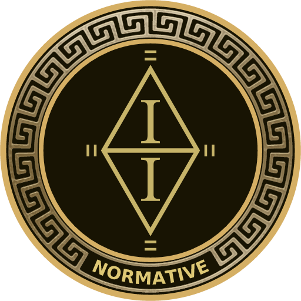
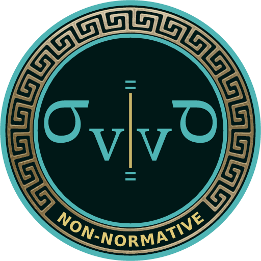
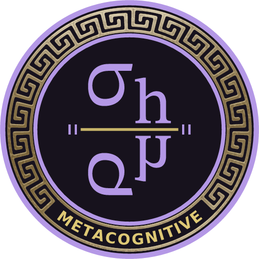
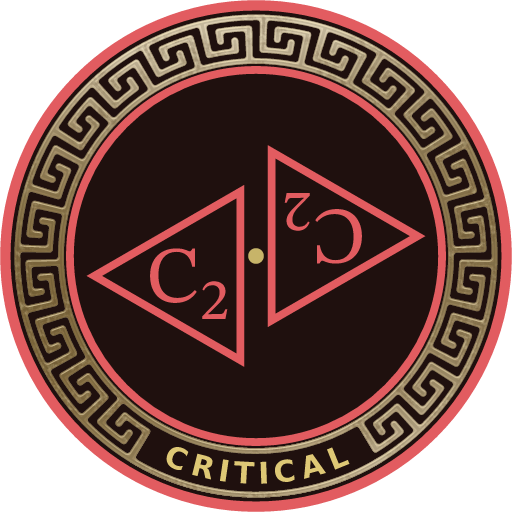

# The four semaphores: masters, pictures, datasheets

These are the Tetrasemaphore's finished files: the ones to use, to print and to cite.

| NORMATIVE | NON-NORMATIVE | METACOGNITIVE | CRITICAL |
|:---:|:---:|:---:|:---:|
|  |  |  |  |
| I | σᵥ | σₕ | C₂ |

| Folder | What it holds | Files |
|---|---|---|
| `vector-masters/` | The layered vector masters, one per semaphore. Open these to edit, to print or to render at any size. | 4 SVG |
| `pictures/` | The finished pictures, ready to place, in five sizes, in English and in Spanish. | 40 PNG |
| `datasheets/` | One sheet per semaphore that takes it apart layer by layer, with the source of every value. | 8 PNG |

## Vector masters

`MASTER-medallion-<STATE>-notation-slot820.svg`. The words "medallion", "notation" and "slot820" are names from the build.

- **Size:** 820 by 820 units, which is 102.8 mm across.
- **Vector only:** no bitmap is embedded, and the lettering is drawn as outlines, so no font is needed.
- **Layers, from the bottom up:** `field`, `finalA5-rings`, `finalA5-geometry`, `finalA5-finish`, `finalA5-litedge`,
  `legend-plaque-en`, `legend-text-en`, `legend-plaque-es`, `legend-text-es`, `glyph-body`, `symmetry-marks`.
  CRITICAL has no `symmetry-marks` layer. The two Spanish legend layers are in every master and are hidden.
- **Rendering:** the gold finish uses SVG filters. A renderer without them draws the ring flat. The pictures here were
  rendered with resvg-js 2.6.2.

## Pictures

`TETRASEMAPHORE-<STATE>-<en or es>-<size>.png`, where `en` is the English lettering and `es` the Spanish.

| Size in pixels | Width when printed at 300 dpi |
|---|---|
| 512 | 43.3 mm (1.71 in) |
| 1024 | 86.7 mm (3.41 in) |
| 1214 | 102.8 mm (4.05 in), the master's own size |
| 1298 | 109.9 mm (4.33 in) |
| 2460 | 208.3 mm (8.20 in) |

Every picture is square, sRGB, tagged 300 dpi, and transparent outside the disc.

## Datasheets

`datasheet_<STATE>.png` is 2400 by 1500 pixels and `datasheet_<STATE>_1200.png` is its 1200 by 750 preview. They are the
files published in release 1.1.0, byte for byte, and they cite that release. Their audit records are in
`../docs/datasheet-audit/`, the report in `../docs/AUDIT_REPORT.md`, and `python3 -I tools/build_datasheets.py --verify`,
run from the top folder, rebuilds them and compares.

## Licence and how to cite

The art is licensed under CC BY 4.0; see `../LICENSE` and `../NOTICE`. To cite the Tetrasemaphore, use
[doi:10.5281/zenodo.23575814](https://doi.org/10.5281/zenodo.23575814), which resolves to the latest version, or the
entry in `../CITATION.cff`.

## Where these files come from

The build record keeps the same masters and pictures, byte for byte, as the evidence of how they were built, in
`../build-record/master/states/proposals/notation/final-masters-2026-10-05/`. That folder is named "proposals" and holds
the final build. `python3 tools/check_semaphores.py`, run from the top folder, proves the two are identical, and every
file's SHA-256 is in `../RELEASE-MANIFEST.md`.
